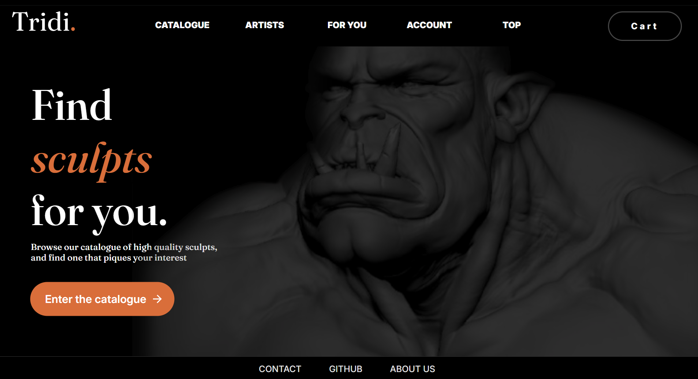
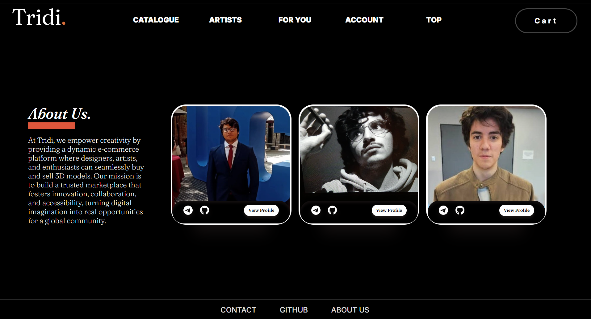

# Tridi - Frontend_26-1
- **Nombre del grupo:** `gitaddpuntoenvguionguionforceampersandampersandgitpushguionguionforce`
- **Integrantes:** `Ignacio Gutiérrez Fuenzalida`, `Francisco Cornejo Quiroga` y `Gonzalo Rivas Valenzuela`

## Sobre el deploy
El *Front* se encuentra deployado en `tridi.jessica.cl`,  hosteado por *Cloudflare*. Usamos este proveedor ya que allí está la DNS del dominio, y ya lo habiamos utilizado antes. Además, deseamos hostear así la *base de datos*, ya sea **local**, o también **Cloudflare**, así evitando que los datos se borren cada vez que se hace *deploy*, o tener que esperar a que *Render* cargue.

## Documento de diseño
Aquí se encuentran las fotos del **Mockup** y del **Documento de Diseño** (al igual que el archivo *figma*). 

Este último será actualizado en cada entrega utilizando *screenshots* de la página.

### Colores

### Botones/Iconos

### Producto

### Mensajes 

### Fuentes

### Logo

### Captura Actual - *Landing Page*

### Captura Actual - *About-Us Page*

## Diagrama E/R
A continuación tenemos lo que es actualmente nuestro **Diagrama Entidad-Relación**. 

Nótese las relaciones N:N que se convertirán a tablas en nuestra base de datos, así también como las entidades principales presentes entre *User* y *Model*, además de los comentarios otorgados por *User* a un *Model*.

*Admin* y *Moderator* heredarán de *User*. El atributo **seller** es un *bool* que marca si el usuario tiene autorización para vender o no.

## Bibliografía - Uso de Código

- **Botón Animado by *ryota1231* > Landing Page:** https://uiverse.io/ryota1231/fast-mouse-17 / Elemento utilizado para animar el botón de *"Enter the catalogue"*.
- **Botón Destacado by *WhiteNervosa* > Footer:** https://uiverse.io/WhiteNervosa/popular-ladybug-27/ / Decoración utilizada para animar los botones del *Footer*, es decir, de la hilera de opciones que están al final de la página.
- **Botón Navbar by *Cornerstone-04* > Navbar:** https://uiverse.io/Cornerstone-04/bitter-impala-54 / Animación utilizada en los botones principales del Navbar. Modificado para igual calzar con la estética de la página.
- **Animación by *Gaurav-WebDev* > Navbar:** https://uiverse.io/Gaurav-WebDev/tall-mayfly-60 / Elemento utilizado para el botón de *'Cart'* en el Navbar, y así diferenciarlo con el resto de botones de navegación.
- **Card Animado by *Centered101* > CardAboutUs:** https://uiverse.io/Centered101/cowardly-newt-15 / Elemento utilizado para animar las tarjetas de presentación personal en el componente *CardAboutUs* utilizados y vistos en la página de */about-us*.