# Tridi - Frontend_26-1
- **Nombre del grupo:** `gitaddpuntoenvguionguionforceampersandampersandgitpushguionguionforce`
- **Integrantes:** `Ignacio Gutiérrez Fuenzalida`, `Francisco Cornejo Quiroga` y `Gonzalo Rivas Valenzuela`

## Descripción
Tridi es un ecommerce de modelos 3D dirigido a amantes de esculturas digitales y artistas, su fin es proveer un servicio de compra y venta. La característica especial de nuestro sitio son los renders 3D dentro de la página, que provee una forma de evaluar bien la escultura antes de comprarla.

## Sobre el deploy
El *Front* se encuentra deployado en `tridi.jessica.cl` hosteado por *Cloudflare*. Usamos este proveedor ya que allí está la DNS del dominio, y ya lo habiamos utilizado antes. Además, deseamos hostear así la *base de datos*, ya sea **local**, o también **Cloudflare**, así evitando que los datos se borren cada vez que se hace *deploy*, o tener que esperar a que *Render* cargue.soytonto

## PWA
Hay una PWA en `tridi.jessica.cl/pwa`, esta es instalable desde la fronpage y desde su página correspondiente, una vez instalada sirve para gestionar los modelos de forma local, es decir, descargarlos y utilizarlos localmente, esta misma feature esta en el perfil de usuario. Se necsita logearse para usar la PWA, ya que así obtendrá los modelos de usuario, en la primera instalación los lodeará de forma automatica, luego hay que darle a un botón, siempre se debe presionar download ya que solo de esta forma lo guardará en una indexedb de forma local.

## Documento de diseño
Aquí se encuentran las fotos del **Mockup** y del **Documento de Diseño** (al igual que el archivo *figma*). 

Este último será actualizado en cada entrega utilizando *screenshots* de la página.

### Colores

### Botones/Iconos

### Producto
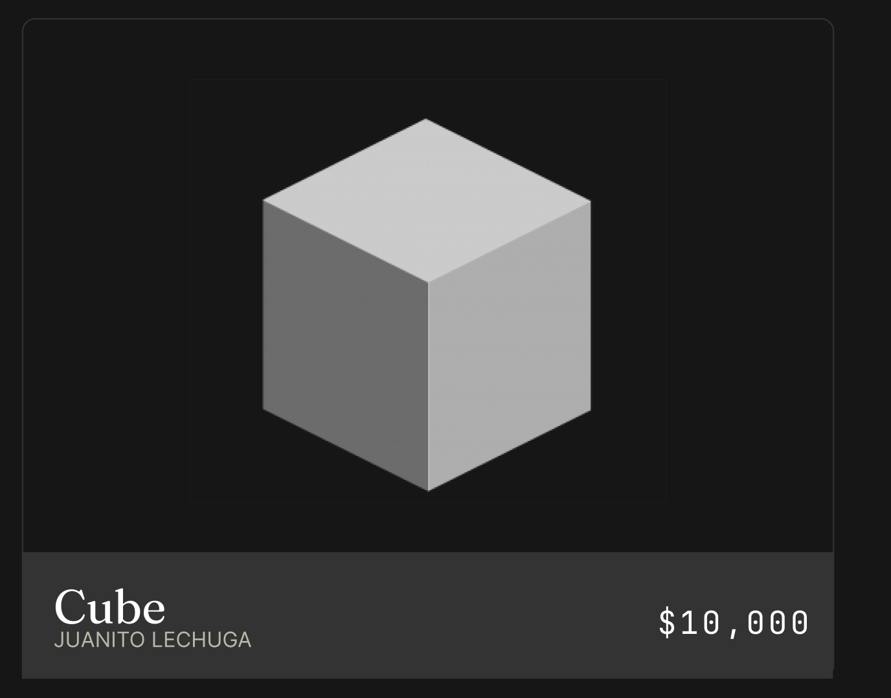

### Mensajes 
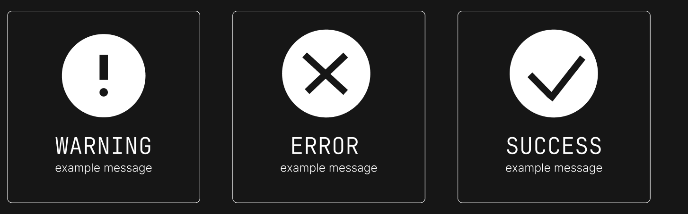

### Fuentes
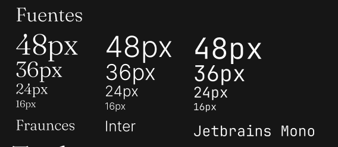

### Logo

### Captura Actual - *Landing Page*
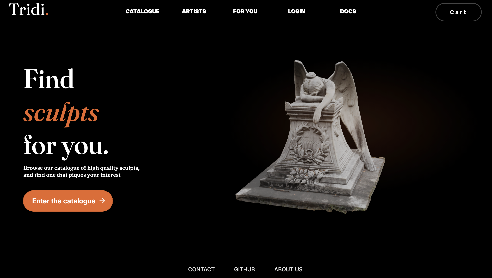

### Captura Actual - *About-Us Page*

### Captura Actual - *Catalogue Page* (*Main Page*)
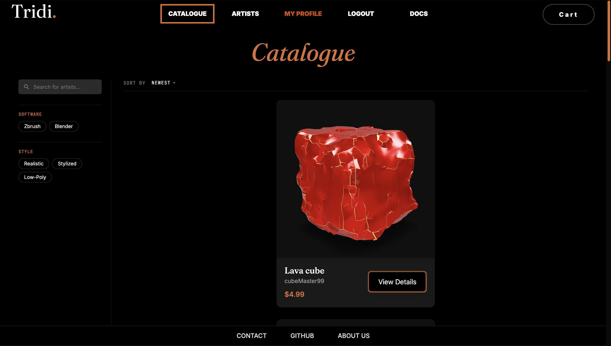

### Captura Actual - *Docs Page*
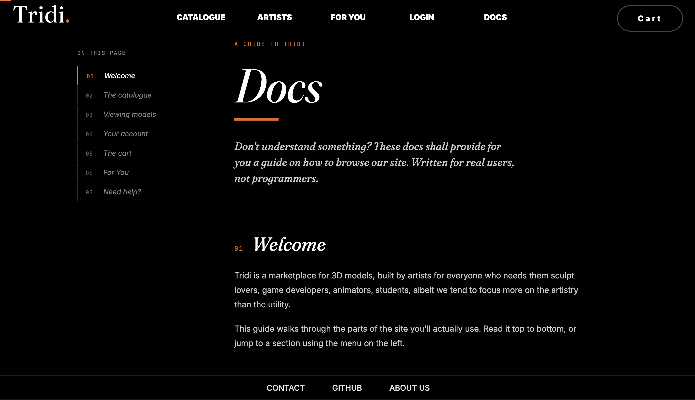

### Captura Actual - *Model View*
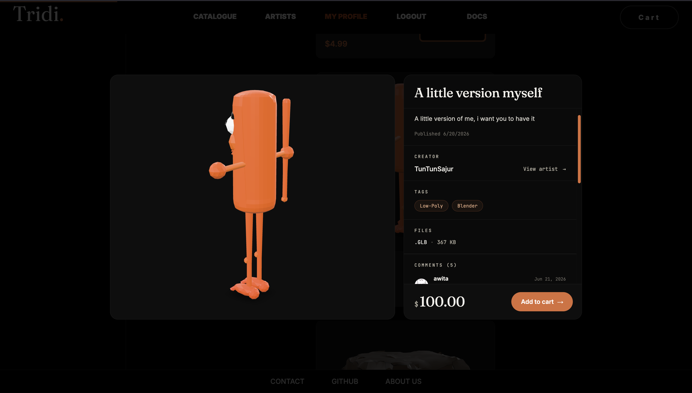

### Captura Actual - *View Cart*
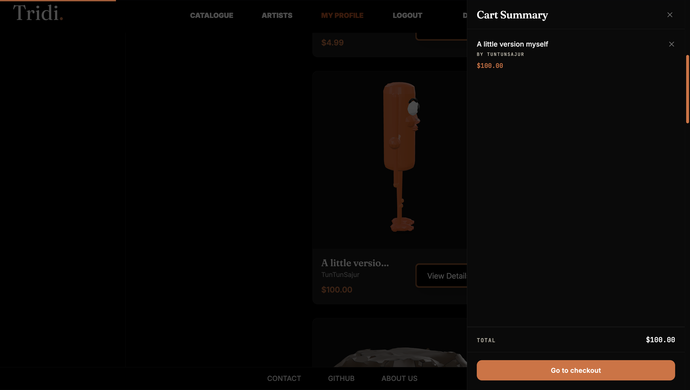

### Captura Actual - *Payment Page*
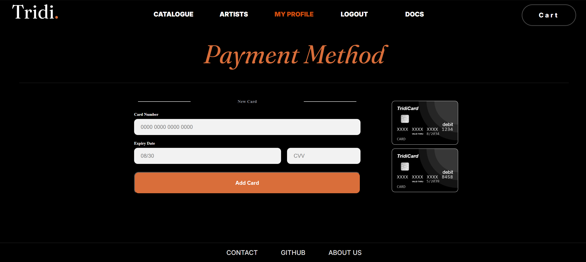

### Captura Actual - *Pending Purchases Page*
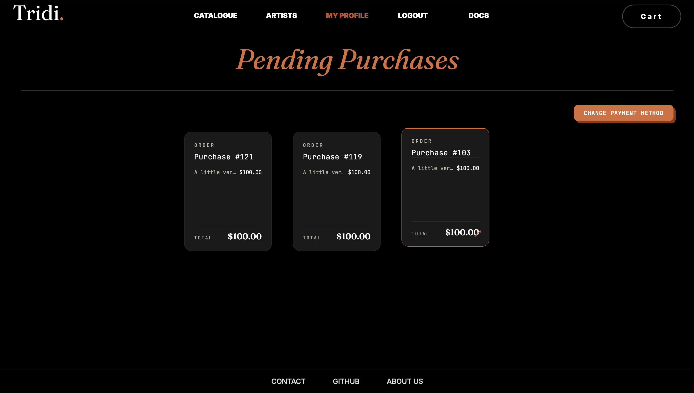

### Captura Actual - *Profile Page*
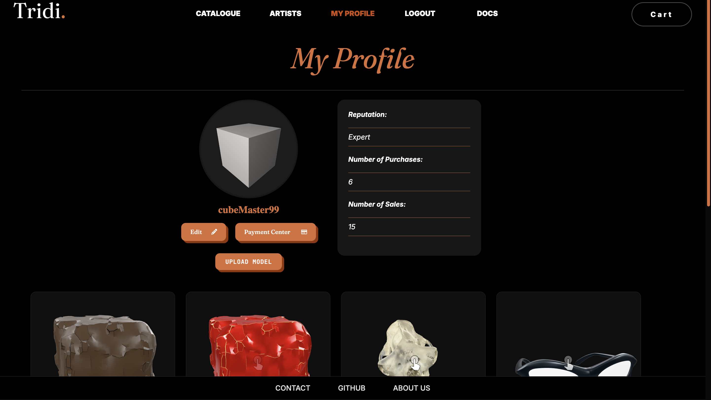

### Captura Actual - *Admin Panel*
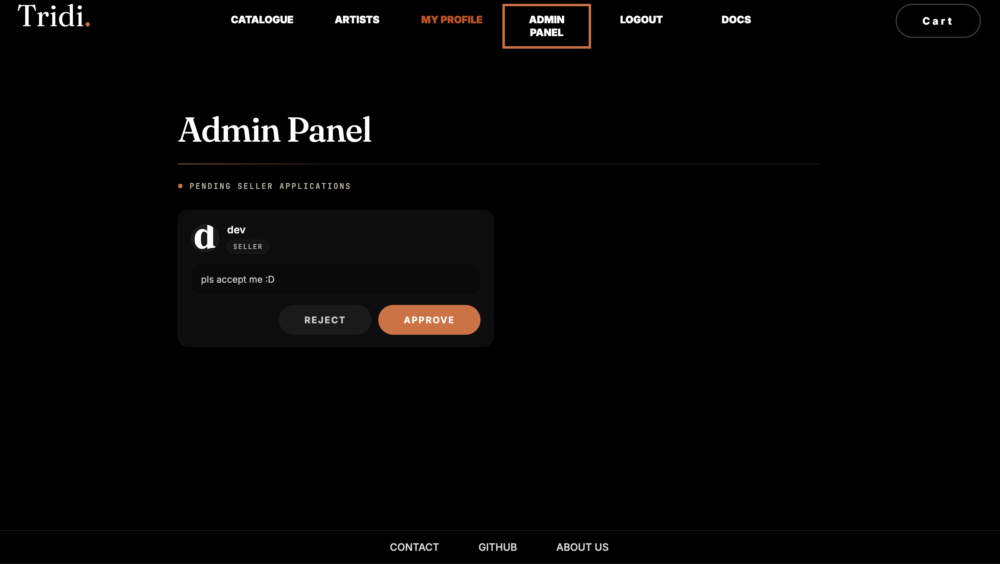

### Captura Actual - *Artists Page*
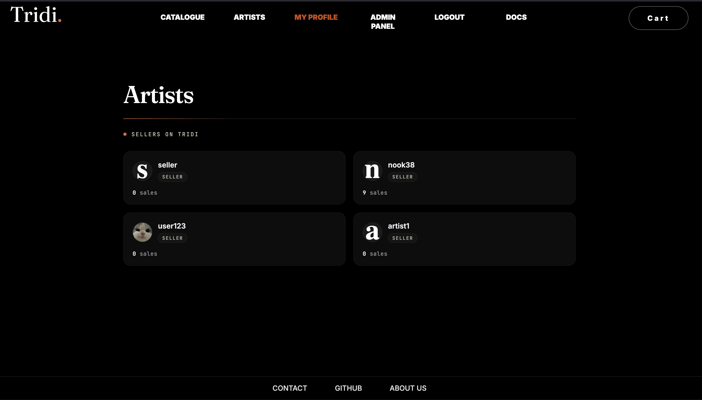 

## Diagrama E/R
A continuación tenemos lo que es actualmente nuestro **Diagrama Entidad-Relación**. 

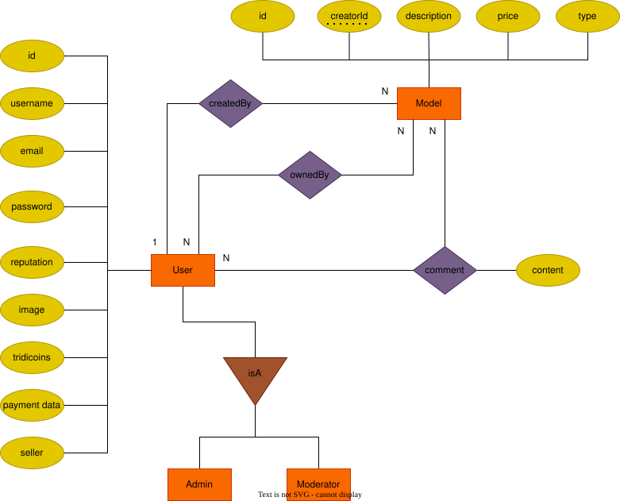

## User stories
1. Como **Moderador** me gustaría catalogar y nivelar a los usuarios según su comportamiento en el sitio, para así llevar un registro y poder diferenciarlos y marcarlos de manera positiva o negativa (Vendedores o Clientes).
2. Como **Administrador** me gustaría tener acceso a vistas exclusivas, como lista total de usuarios y nivel de comportamiento de sus cuentas, para controlar la calidad de la comunidad deseada en el sitio.
3. Como **Vendedor**, quiero poder ver, agregar, y vender modelos 3D que yo suba a mi tienda, para así generar ingresos.
4. Como **Cliente**, quiero iniciar sesión, para guardar mis datos y poder comprar modelos.
5. Como **Cliente** quiero ver los modelos 3D dentro del sitio, y así poder evaluar mejor si los quiero comprar.
6. Como **Administrador** me gustaría quitar contenido de mala calidad, sea comentarios o modelos, así manteniendo la calidad del sitio.
7. Como **Vendedor** quiero tener links a mis redes sociales, para lograr tener una mayor audiencia.
8. Como **Vendedor** me gustaría tener un perfil donde pueden ver todos mis productos, para tener todos mis productos en un solo lado.
9. Como **Cliente** quiero tener varios métodos de pago, para facilitar mis compras.
10. Como **Cliente** quiero descargar los modelos 3D que haya comprado, para tenerlos en mi propiedad.
11. Como **Cliente**, quiero comprar sin necesidad de registrarme, para no tener cuentas innecesarias, ni exponer datos.
12. Como **Cliente**, quiero dejar comentarios para hacer comentarios positivos o negativos del modelo 3D, de esta forma, informo al resto de clientes sobre su calidad.
13. Como **Administrador** quiero banear a usuarios problemáticos, para mantener la integridad del sitio.
14. Como **Cliente** quiero recibir recomendaciones de modelos 3D, para que salgan productos relevantes para mi.
15. Como **Cliente** quiero tener un historial de productos visitados, por si me interesa uno y lo quiero ver de nuevo.
16. Como **Vendedor** quiero tener tags para que mis productos sean más fáciles de encontrar.
17. Como **Cliente** quiero tener una wishlist, para así marcar los productos en los que estoy interesado.

## Bibliografía - Uso de Código

- **Botón Animado by *ryota1231* > Landing Page:** https://uiverse.io/ryota1231/fast-mouse-17 / Elemento utilizado para animar el botón de *"Enter the catalogue"*.
- **Botón Destacado by *WhiteNervosa* > Footer:** https://uiverse.io/WhiteNervosa/popular-ladybug-27/ / Decoración utilizada para animar los botones del *Footer*, es decir, de la hilera de opciones que están al final de la página.
- **Botón Navbar by *Cornerstone-04* > Navbar:** https://uiverse.io/Cornerstone-04/bitter-impala-54 / Animación utilizada en los botones principales del Navbar. Modificado para igual calzar con la estética de la página.
- **Animación by *Gaurav-WebDev* > Navbar:** https://uiverse.io/Gaurav-WebDev/tall-mayfly-60 / Elemento utilizado para el botón de *'Cart'* en el Navbar, y así diferenciarlo con el resto de botones de navegación.
- **Card Animado by *Centered101* > CardAboutUs:** https://uiverse.io/Centered101/cowardly-newt-15 / Elemento utilizado para animar las tarjetas de presentación personal en el componente *CardAboutUs* utilizados y vistos en la página de */about-us*.

## Playwright
Para correr los tests se debe usar `pnpm test`, **Advertencia:** El último test demora entre uno a dos minutos ya que se 
usa el backend online.

## IndexedDB
Se agregó IndexedDB para guardar los modelos 3D, se guardan los archivos localmente al visitar la página más de una vez.

## Uso de IA
Tanto en el front como el back se uso IA para generar código y documentación.
