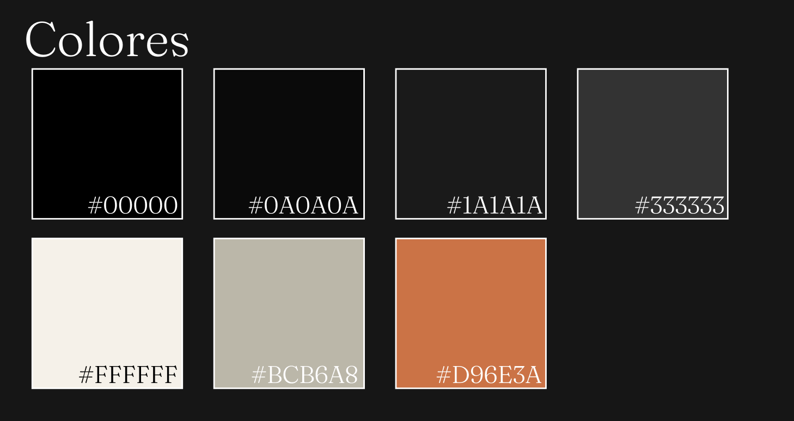
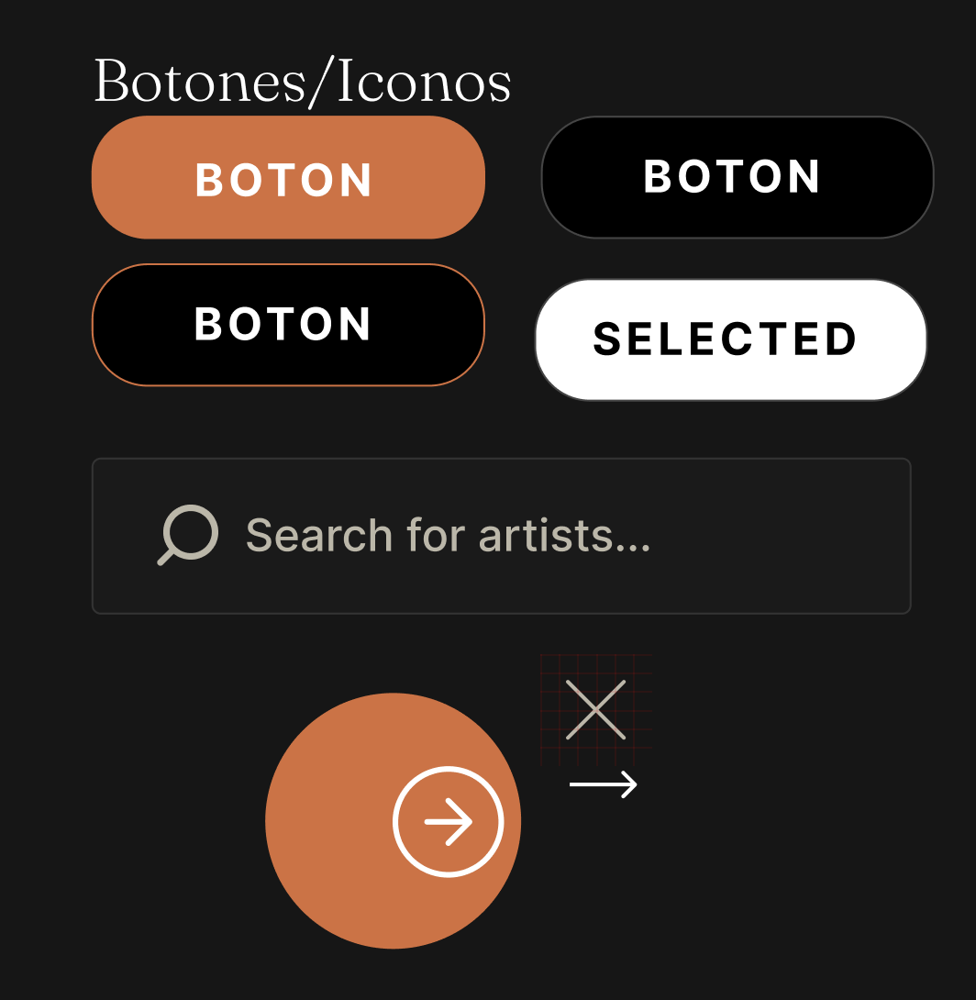

# tridi frontend_26-1
- Nombre del grupo: `gitaddpuntoenvguionguionforceampersandampersandgitpushguionguionforce`
- Integrantes: `Ignacio Gutiérrez Fuenzalida`, `Francisco Cornejo Quiroga` y `Gonzalo Rivas Valenzuela`

## Sobre el deploy
El front se encuentra deployado en `tridi.jessica.cl` hosteado por Cloudflare. Usamos este proveedor, ya que allí está la DNS del dominio además de que ya lo habiamos utilizado antes. Pero principalmente porque deseamos hostear la base de datos, ya sea local, o bien en cloudflare también, así evitando que los datos se borren cada vez que se hace deploy, o tener que esperar a que render cargue.

# Documento de diseño
Aquí se encuentran fotos del mockup y documento de diseño (al igual que el archivo figma).

Este último será actualizado en cada entrega utilizando screenshots de la página.

## Colores

## Botones/Iconos

## Producto

## Mensajes 

## Fuentes

## Logo

